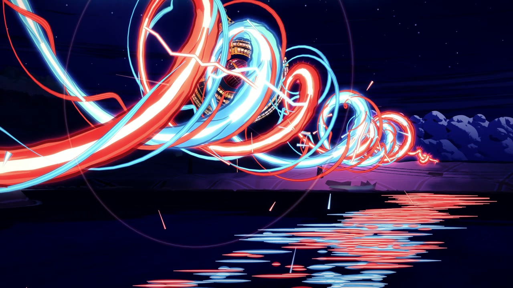
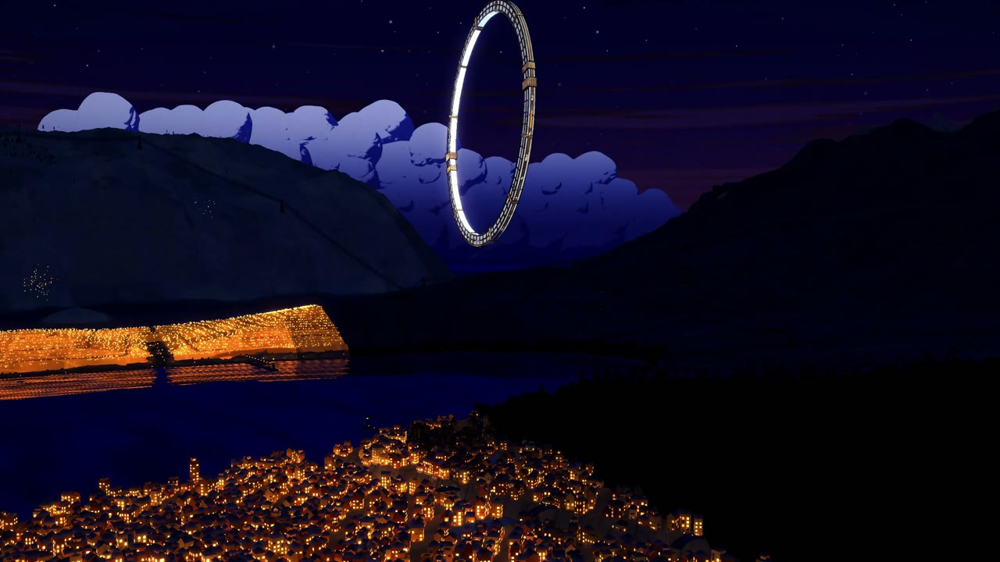
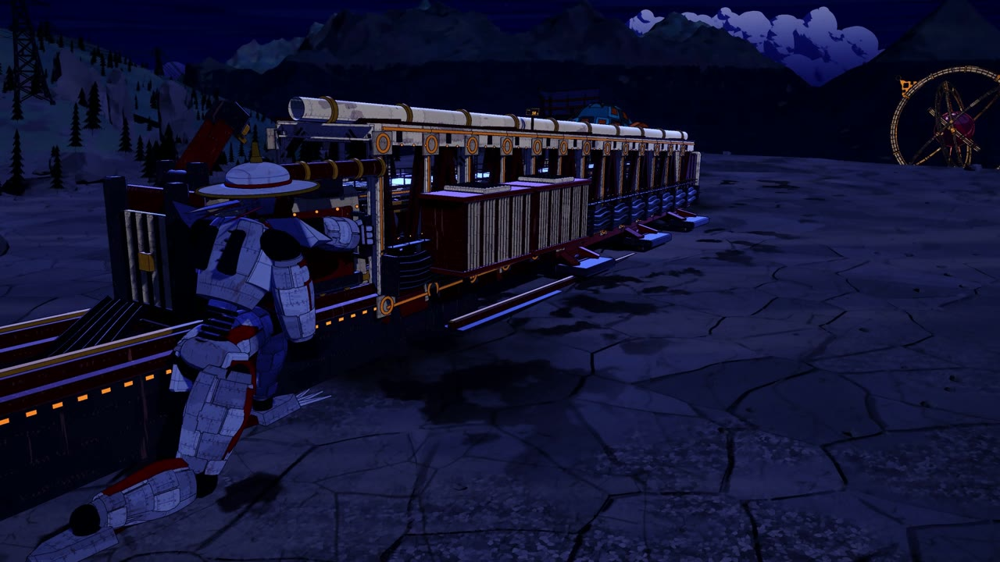
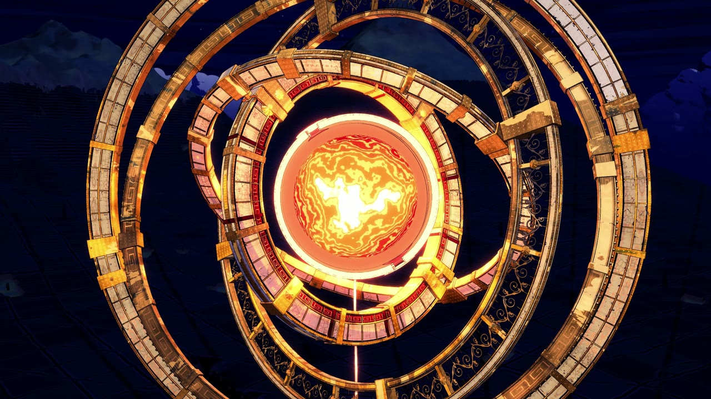
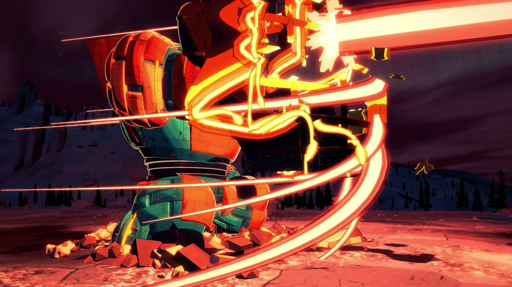
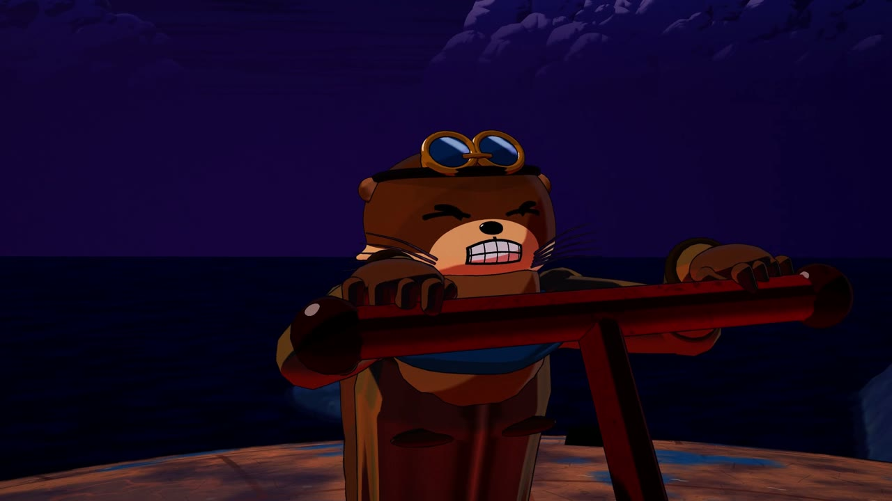
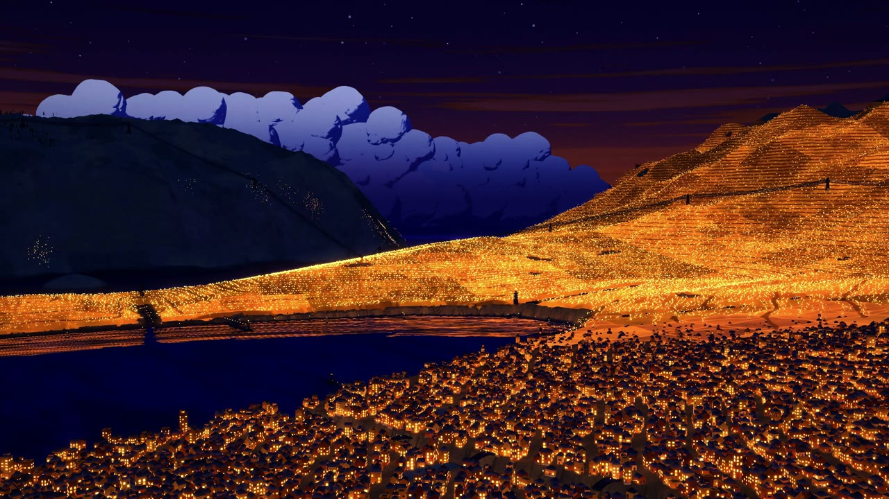

# BLACKOUT · 停電

A 79-second anime short where every frame is made by code: no video model, no image model, no hand-drawn frames.
A harbour country switches off every light it has, district by district, and sends all of its power along the wires into
one mountain-sized rail cannon aimed at the Orrery, a floating golden astrolabe. The Orrery answers, the two beams twist
around each other and both miss. While the gun recharges, a squat copper mech jumps in front of it and holds a shield that
melts away in the beam. The second shot goes through the core. An otter boy tears open a burning hatch with his bare paws,
a snow-leopard girl opens her eyes and smiles for the first time, and the lights come back across the country.

The scene is a shot-for-shot retelling of a famous anime sequence: the same actions, staging and timing, with every visual
(country, characters, machines, enemy, colours) designed from scratch.



| | |
|---|---|
|  |  |
|  |  |
|  |  |

**Watch:** [film/blackout.mp4](film/blackout.mp4) (1920×1080, 24 fps, 79.4 s; click "View raw" to download).

Made with Claude Fable 5.2 in Claude Code.

---

## How it looks like anime

three.js (WebGL2) builds the whole world in the browser and a chain of full-screen passes draws every frame the way a
cel + painted-background production would:

| Pass | What it does |
|---|---|
| shadow | one shadow map with hard cel edges |
| main (MRT) | colour with cel light, plus depth, object id, material id and normals |
| paint | Kuwahara gouache brush on the backgrounds only |
| ink | lines from object-id, depth and normal edges, only where a material asks for ink; thinner far away |
| atmosphere | night haze, moonlight and smoke |
| overlay / bloom / final | beams, sparks and fire drawn as inked 2D-style shapes; bloom; film grade |

* **Everything is 3D under the drawing.** Terraced towns with thousands of lit windows, stone seawalls, power pylons over
  snowy conifer hills, basalt cliffs, a ridge with a giant rail cannon built from transformers and truss, a white and red
  sniper mech, a copper and teal mech with a ship's-bow shield, an enemy of nested golden rings around a ruby core, and a
  cast of otters, raccoons, badgers and a snow leopard on a shared rig with anime faces. About 5.7 million triangles.
* **Texture at three scales.** Ground, rock, walls and metal carry macro blotches, meso cracks and micro chips
  (`src/detail.js`, `src/bgmaterials.js`), fading with distance.
* **Light only changes with a visible cause.** Every beam and blast lights the land and the machines around it.
* **Animation is on twos, FX on threes**, like film anime; living things shift weight, plant their feet, anticipate,
  overshoot and settle, with follow-through on ears, tails and clothes (`src/motion.js`). Heavy machines land with mass.
* **One map and one clock.** `src/layout.js` is the shared map and `src/shots.js` holds the story cues and the 34 shots;
  every department places and times things from those numbers, so the world stays continuous across cuts.
* **Checked before rendering.** `tools/qa.mjs` tests the frames on the real geometry with BVH trees (no hand, foot or body
  inside the armour, the ground or another body; the camera never inside a mesh or under the ground),
  `tools/smooth.mjs` flags camera jerks and `tools/pops.mjs` flags anything that appears or vanishes mid-shot.
* **The score uses real orchestral samples** (see [audio/CREDITS.md](audio/CREDITS.md)) plus designed SFX, all mixed from
  code in `audio/render.py`. It stays in C minor until the very last beat, with the only major chord of the film when the
  last lamp comes back on ([audio/cuesheet.md](audio/cuesheet.md)).

## How it was made

One director session and parallel agent teams in Claude Code, working from a shared contract
([CONTRACT.md](CONTRACT.md)): world, enemy, machines, characters, FX, sound. Each team owned its own files and cameras and
rendered stills to check its work before the final render.

## Run it

Requirements: Node 18+, Google Chrome (set `CHROME` if it is not in the default place), `ffmpeg` on `PATH`, and
Python 3.11+ with `numpy`, `scipy` and `soundfile` for the score.

```bash
npm install
npx http-server . -p 8080        # or any static server; open http://localhost:8080 for the scrubbable workbench
node tools/check.mjs             # load check
node tools/qa.mjs --step 2       # BVH checks on every second frame
node tools/snap.mjs t:47 --scale 0.5
```

Build the score (downloads the CC0 samples once, see [audio/README.md](audio/README.md)):

```bash
python -I audio/tools/fetch_samples.py
python -I audio/tools/build_index.py
python -I audio/render.py
```

Render all 1,906 frames and mux the film with `out/soundtrack.wav`:

```bash
node tools/render.mjs --scale 2 --name blackout
```

## Layout

```
CONTRACT.md         the production contract: shot list, designs, map, file ownership, APIs, QA rules
index.html          the workbench (scrub / play) and the headless render page
src/engine.js       the render passes; look.js the grade presets; detail.js the multi-scale texture
src/layout.js       the shared map; shots.js the cues and the 34 shots
src/land*.js        the country, towns, power lines          src/orrery*.js  the enemy and its collapse
src/mech*.js        the cannon, the Heron, the Tortoise       src/folk*.js    the characters: rig, faces, species, acting
src/fx*.js          beams, helix, rockets, fire, water       src/world*.js   sky, moon, aurora
src/cams/*.js       each department's cameras and looks for its shots
tools/              check, snap, sheet, qa, smooth, pops, render
audio/              the score, its sample engine, SFX, cue sheet and credits
vendor/             three.js r170, three-mesh-bvh, addons
```

## Credits and license

MIT. The render engine and some modelling and FX code are adapted from the Leviathan project (MIT,
[vendor/LEVIATHAN-LICENSE](vendor/LEVIATHAN-LICENSE)). three.js and three-mesh-bvh are MIT. The orchestral samples are
CC0 ([audio/CREDITS.md](audio/CREDITS.md)); they are downloaded by the fetch script, not stored here.
